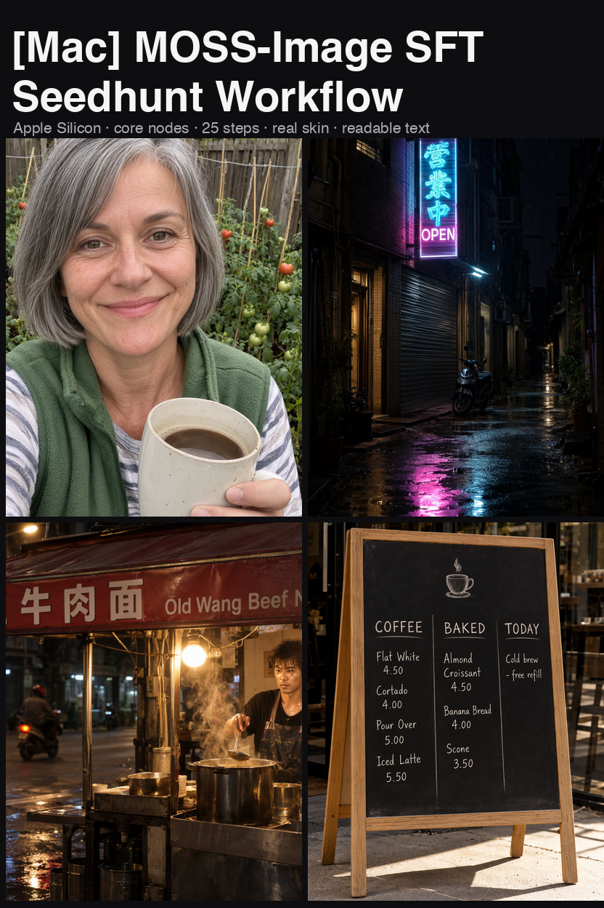
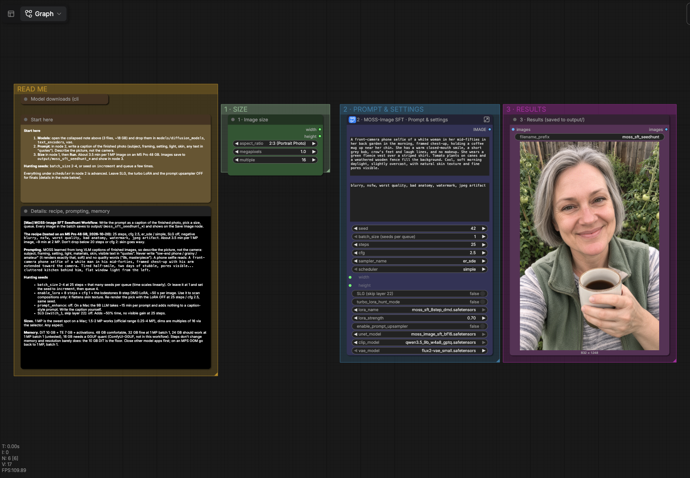

# [Mac] MOSS-Image SFT Seedhunt Workflow

Seed hunting workflow for MOSS-Image SFT on Apple Silicon. Native ComfyUI nodes only, no custom packs. Also on [Civitai](https://civitai.com/models/3012112/mac-moss-image-sft-seedhunt-workflow).

Good at: legible text in scene (English and Chinese, signs, menus, posters, neon, multi-line), long prompts, photoreal skin, phone selfies, older faces, anime.

Four colour groups on the canvas: READ ME (notes), 1 SIZE, 2 PROMPT & SETTINGS, 3 RESULTS.

## Requirements
ComfyUI master from 2026-10-20 or newer (native MOSS-Image, commit b1a247c+). Apple Silicon (MPS) or CUDA. Memory: 48 GB comfortable, 32 GB fine at 1 MP batch 1, 24 GB should work at 1 MP batch 1 (untested), 16 GB needs a GGUF quant via ComfyUI-GGUF (not included). Steps don't change memory, resolution barely does; the 10 GB DiT is the floor.

## Install
From HF Comfy-Org/MOSS-Image:
- diffusion_models/moss_image_sft_bf16.safetensors (10.2 GB) -> models/diffusion_models
- text_encoders/qwen3.5_9b_w4a8_gptq.safetensors (7.3 GB) -> models/text_encoders
- vae/flux2-vae_small.safetensors (0.2 GB) -> models/vae
- Optional: lodestones/MOSS-Image-SFT-8-steps-dmd lora_latest.safetensors (1.2 GB) -> models/loras/moss_sft_8step_dmd.safetensors

## Quick start
1. Drop MOSS-Image-SFT_Mac_SeedHunter.json in ComfyUI and load it.
2. Point nodes at the files above.
3. Queue.

## Settings
- 25 steps, cfg 2.5, er_sde, simple, 1 MP: default recipe, official 50/cfg 3 gave same sharpness at double the time.
- turbo_lora_hunt_mode: 8-step LoRA + cfg 1, ~50 s, for scanning compositions.
- LoRA off for finals: the 8-step LoRA makes skin waxy.
- SLG (layer 22) off: +50% time, no visible gain.
- enable_prompt_upsampler off: ~15 min per prompt on Mac, no gain.

## Prompting
- Write a caption of the finished image: subject, framing, setting, light, materials, skin.
- Visible text in quotes with position.
- No camera talk or quality words ("35mm", "8k"): the model renders those literally and the image goes soft.

## Troubleshooting
- MPS OOM: drop to 1 MP, batch 1.
- Text illegible: try 2-4 seeds, pick the legible one.
- Soft images: remove camera/quality words from prompt.
- int8_convrot variants: CUDA only.

## Demos
`gallery/` holds the 20 demo renders straight from this workflow at default settings (nothing edited); `demos.json` has the exact prompts. M5 Pro 48 GB, ~3.5 min per 1 MP image.

## Credits
OpenMOSS (model), Comfy-Org (native support + template), lodestones (8-step LoRA), kijai (template settings).
